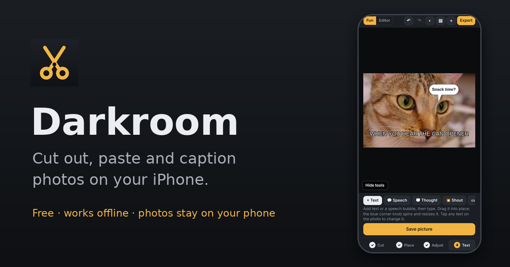

# Darkroom

A free photo app for iPhone: paint over anything to cut it out, drop it onto another photo, and add captions, speech bubbles or your own writing. It runs in the browser, works offline once installed, and your photos never leave your phone.

## Get it

1. On your iPhone, open **https://nathan-san1981.github.io/darkroom/** in **Safari**.
2. Tap **Share**, then **Add to Home Screen**.

Darkroom then opens from its own icon, full-screen like any other app. (It also works in Chrome or on Android, just without the Home Screen step being quite as smooth.)

## How it works

Darkroom is built around one thing: cutting something out of one photo and putting it on another. Four steps run along the bottom:

1. **Cut.** Pick a photo and roughly paint over what you want, or draw a loop around it. When you lift your finger the edge snaps to the real outline. **− Remove** fixes spots it got wrong; pinch with two fingers to zoom in for fine edges.
2. **Place.** Pick the photo to paste onto (or the same one). Your cutouts are kept in a tray for next time.
3. **Adjust.** Drag the cutout to move it. Drag the blue corner knob around to spin it, in or out to resize. Sliders for see-through (to line it up) and brightness (to match the new photo), plus flip, outline and shadow. **+ Photo on top** lays a whole second photo over yours; switch the finger to **Erase** to rub away the parts you don't want.
4. **Text.** Comic bubbles in one tap: speech, puffy thought clouds, spiky shout, dashed whisper, yellow caption boxes and a POW! sound effect, in real comic lettering. Drag the blue dot to aim a bubble's tail. Plus captions in one-tap styles (Meme, Bold, Marker, Script, Neon, and more) and writing with your finger. **Paint over** and **Cover box** hide things first, and **Pick color from photo** matches the paint to the background.

Then tap **Save picture**. On iPhone the share sheet opens, so choose **Save Image** to put it in Photos.

Need more? **More tools** at the top opens the full editor: exposure and color, filters and looks, crop and straighten, heal and clone, drawing and shapes, frames, layers, and export as JPEG, PNG or WebP.

Your work is saved as you go. If iPhone reloads the page while you're in another app, tap **Continue editing** to pick up where you left off.

## Privacy

Everything happens on your phone. Photos aren't uploaded anywhere, and there are no accounts or ads. The only things downloaded are the app itself, its fonts, and (only if you use **Tap select** in the editor) a small AI model.

---

### Technical notes

- `index.html` is the whole app: plain HTML, CSS and JavaScript, no build step. Sample photos are embedded.
- `manifest.webmanifest` and `sw.js` make it installable and offline-capable. Bump `CACHE` in `sw.js` on each release so installed copies update.
- `icon.png`, `apple-touch-icon.png` are the Home Screen icons; `preview.png` is the link-preview card.
- Magic brush is an on-device GrabCut-style segmentation (color models plus contrast-aware smoothing). Tap select uses SlimSAM via transformers.js, loaded from jsDelivr and Hugging Face on first use, with a color-based fallback.
- Sample photos are from scikit-image's bundled data set (public domain / CC0).
